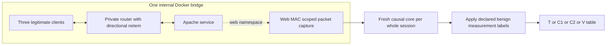

# Controlled legitimate development stress

Use the current plan `../../plan/benign_stress_v5.json`. It declares 36 fresh whole sessions: T/C1/C2/V × three conditions × three repetitions, each with three clients, a 30-second warm-up and a 60-second measurement. Three separately seeded PREFLIGHT sessions are excluded. Exact effective client and netem seeds are globally disjoint from the selected original benign lab and every earlier stress plan. The runtime image content ID is the image built for stress v4: embedded client/network/capture sources are byte-identical; v5 adds host-side clock/power safeguards only.

| Condition | Legitimate workload | Router-to-client / router-to-web shaping |
| --- | --- | --- |
| mixed_keepalive | Complete GET/HEAD, 4 KiB/64 KiB/256 KiB objects, at most eight requests per persistent connection | None |
| long_download | Complete GET headers for 1 MiB responses; one outstanding request per client | Shared 512 kbit/s and 40 ms delay / 40 ms delay |
| congested_mixed | Same varied GET/HEAD workload | 256 kbit/s, 120±20 ms delay, 1% loss, queue 64 / 60±10 ms delay, 0.5% loss, queue 64 |

All client headers are sent immediately and no request body is withheld. Mixed clients use 0.3–0.8-second seeded think times, two-second socket timeouts and a ten-second response budget. Bulk clients use ten-second socket timeouts and a ninety-second response budget. Inflight responses are stopped by measurement end + 20 seconds, subject to one final bounded socket read. Request failures, server errors, retransmissions and deliberately dropped network packets remain legitimate outcomes. Body-integrity or HTTP state-machine bugs and off-scope/corrupted evidence are engineering failures; they do not become hard benign examples.

One **internal Docker bridge** has no published ports, host networking or external default routes. /32 client→web and web→client routes force the private router hop without NAT. Router ICMP redirects are disabled. Direction-specific netem children classify destination addresses. The audit verifies the router peer MAC in every actual service frame; capture disables promiscuity and matches the web MAC, excluding unrelated flooded bridge copies. Only container interfaces/routes/offloads are changed. Root qdisc counters can aggregate children: report leaf netem drops once and keep them separate from tcpdump kernel capture drops.

The logical route and evidence path are:



/32 routes force the router hop; the audit checks its peer MAC. Preflights never enter a model table. Role ownership is declared before traffic, and the feature core is restarted for every session.

Host/VM clocks are probed before and during collection. A host-loop pause over five seconds, a clock-probe interval over twenty seconds, excessive clock uncertainty or an incomplete capture interval rejects the attempt. A process-scoped Windows idle-sleep request is cleared on exit; it does not change global power/display settings or override manual sleep/lid closure. Such interruptions can still invalidate a run. Linux-side capture is flushed before copying to Windows. Fresh web/router containers and exact unique seeds support provenance; this remains one host/environment and does not establish independent environments or realistic WAN fidelity.

From the project root, with the pinned Python dependencies and Docker CLI on PATH:

```powershell
& '.\phase 3\.venv\Scripts\python.exe' -X utf8 'phase 3/src/run_benign_stress_v5.py' --preflight
# Inspect all three preflight audits and causal replay before development.
& '.\phase 3\.venv\Scripts\python.exe' -X utf8 'phase 3/src/run_benign_stress_v5.py'
& '.\phase 3\.venv\Scripts\python.exe' -X utf8 'phase 3/src/integrate_benign_stress.py'
```

Do not rerun completed historical plans as though seeds reproduce exact PCAP bytes. The collector verifies declared source/image hashes, saves every attempt and refuses automatic recollection after a failed entry. Preserve failures and declare reviewed replacements separately. Never run simultaneous collections on this fixed subnet. The v5 integrator requires all 36 declared entries, audits raw evidence, verifies fresh state and replays each observed capture interval through the **unchanged causal core**. Measurement labels are applied after feature construction. Known observed idle tails advance expiry and rolling history; they are not zero-filled CSV rows. PREFLIGHT and every superseded stress session stay outside the input registry. Raw data stays under ignored `data/lab_stress_v5/`; transfer it separately for byte-exact replay.

This is benign development only. Main model fitting/freezing, reserved slow-family testing, final benign stress, all lab attack sessions and external transfer remain separate. Sparse known-V coverage and class/source/service/path confounding still require review.

Implementation references: [Docker internal networks](https://docs.docker.com/reference/compose-file/networks/), [iproute2 netem manual](https://github.com/iproute2/iproute2/blob/main/man/man8/tc-netem.8), [CPython HTTP response state/read handling](https://github.com/python/cpython/blob/3.12/Lib/http/client.py), [Windows execution-state API](https://learn.microsoft.com/en-us/windows/win32/api/winbase/nf-winbase-setthreadexecutionstate).
